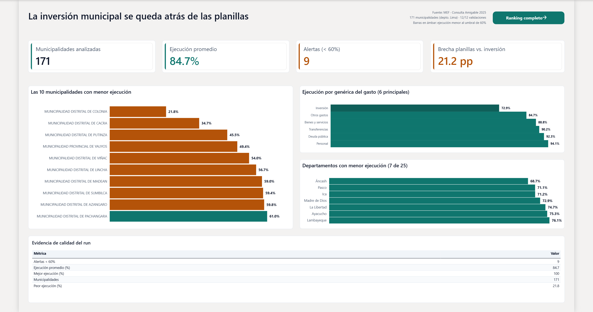
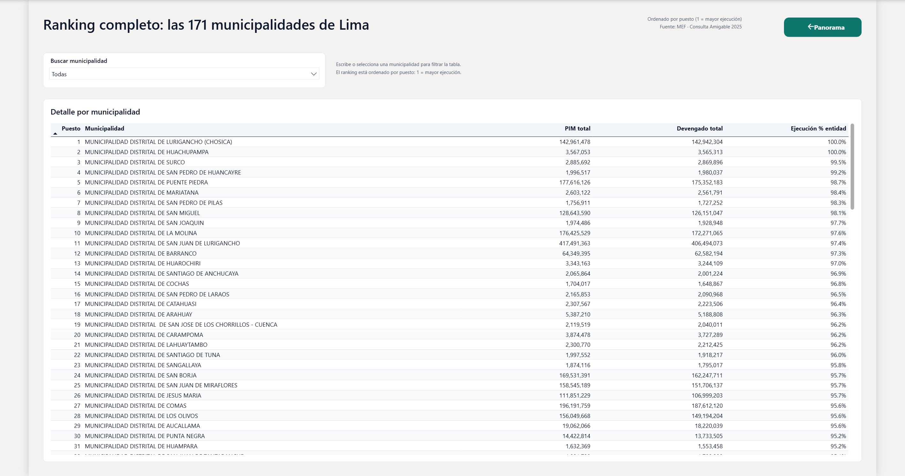

# PresupuestoAbiertoPE

**Pipeline de datos abiertos con calidad y nube.**

PresupuestoAbiertoPE convierte la ejecución presupuestal de las municipalidades (exportaciones oficiales del MEF) en un medallion **bronze → silver → gold** con **12 validaciones de calidad**, y responde una pregunta simple: ¿qué municipalidades ejecutan menos, en qué categorías y en qué meses?

> **Estado:** v0.1.0 — pipeline medallion, 12 validaciones, dashboard PBIP y evidencia BYOD 2025.
>
> **English:** [README.en.md](README.en.md)

---

## ¿Por qué PresupuestoAbiertoPE?

Los datos de ejecución presupuestal de las municipalidades están dispersos y son difíciles de comparar. La Consulta Amigable del MEF permite consultar pliego por pliego, pero no compararlos todos a la vez. Ciudadanos, periodistas y gobiernos locales no tienen un tablero simple para detectar baja ejecución o prioridades.

PresupuestoAbiertoPE responde:

- ¿Qué % de su PIM ejecutó cada municipalidad?
- ¿Qué categorías (genéricas) tienen menor ejecución?
- ¿Qué meses concentran la caída de la ejecución?
- ¿Qué entidades tienen baja ejecución de forma sostenida?

---

## Qué hace

1. **BYOD:** tú descargas la exportación oficial (HTML-`.xls`) de la Consulta Amigable del MEF con tu navegador.
2. **Bronze:** el pipeline lo ingiere crudo con procedencia y hash de fila.
3. **Silver:** tipa, deduplica, resuelve catálogos y pone en cuarentena lo inválido.
4. **Quality:** 12 validaciones con gate; si hay un `fail`, no se construye gold.
5. **Gold:** % de ejecución por municipalidad, categoría y mes, con rankings (window functions).
6. **Hallazgos:** bottom-N de ejecución, categorías críticas y alertas.
7. **Dashboard:** PBIP reproducible de 2 páginas (panorama y ranking) y exports CSV con checksums.

No scrapea el MEF, no inventa hallazgos y no acusa: describe ejecución presupuestal con lenguaje neutral.

---

## Demo

### Dashboard (BYOD real, 2025)





El proyecto PBIP está en [`dashboard/`](dashboard/). Para abrirlo, actualizar el modelo y guardar el `.pbix` final, sigue [`docs/dashboard.md`](docs/dashboard.md).

---

## Arquitectura

```text
Exportes BYOD oficiales (navegador humano) → data/raw/*.xls
        │
        ▼
     ingest ──► BRONZE (Delta, fila cruda + procedencia)
        │
        ▼
    transform ──► SILVER (Delta, tipos + dedupe + catálogos + cuarentena)
        │
        ▼
     quality ──► 12 validaciones SQL → quality_report.json (gate)
        │
        ▼ (solo si el gate pasa)
    analytics ──► GOLD (Delta, % ejecución + rankings + hallazgos)
        │
        ▼
    reporting ──► artifacts/e2e/ + exports CSV + dashboard/
```

**Contextos:** `ingest`, `transform`, `quality`, `analytics`, `reporting`, `shared`.

**Reglas:**

- La sesión Spark se crea en un solo lugar.
- El SQL de negocio vive en `transforms`/`analytics`, no en notebooks ni CLI.
- Las validaciones leen silver con SQL propio; nada tautológico.
- El pipeline es idempotente: re-ejecutar no duplica datos.
- Los archivos BYOD nunca se commitean; el manifest registra su SHA-256.

---

## Stack

| Capa | Tecnología |
|---|---|
| Motor | Apache Spark (PySpark) local |
| Formato | Delta Lake (pip: `delta-spark`) |
| Lenguaje | Python 3.13 + PySpark 4.2 + Delta 4.4 (verificado con `pip --dry-run`) |
| Requisitos | Java 17 |
| Calidad | 12 validaciones SQL con registro propio y gate |
| Dashboard | Power BI (exports CSV + especificación reproducible) |
| Testing | pytest, E2E-first, artefactos con checksums |
| CI | GitHub Actions (Java 17 + Python 3.13) |

**Equivalencias documentadas:** Databricks (notebooks wrapper), Prefect (orquestación programada), MinIO (storage). Ninguna es dependencia del MVP.

---

## Las 12 validaciones

| # | Nombre | Nivel | Qué verifica |
|---|---|---|---|
| 1 | `raw_schema_present` | fail | Columnas obligatorias del CSV |
| 2 | `raw_row_count` | fail | Filas mínimas |
| 3 | `raw_parseable` | warn | % numéricos parseables |
| 4 | `silver_types` | fail | Tipos: año, mes 1–12, montos |
| 5 | `silver_no_null_keys` | fail | Clave sin nulos |
| 6 | `silver_unique_keys` | fail | Sin duplicados |
| 7 | `silver_catalog_referential` | fail | Pliegos en catálogo |
| 8 | `silver_entity_named` | warn | Entidad no placeholder |
| 9 | `business_devengado_le_pim` | fail | Devengado ≤ PIM |
| 10 | `business_amounts_positive` | fail | Montos ≥ 0 |
| 11 | `business_cumulative_monotonic` | warn | Acumulado no decreciente (`LAG`) |
| 12 | `business_coverage_months` | warn | Cobertura de meses |

Un `fail` detiene gold; un `warn` se reporta. Todo queda en `quality_report.json` con conteos y muestras.

---

## Inicio rápido

> Requisitos: Java 17, Python 3.13, ~2 GB de RAM libres (cierra Docker si hace falta). En Windows, instalar `winutils.exe` una vez (documentado en Fase 0).

```powershell
git clone <repository-url>
cd presupuestoabierto

python -m venv .venv
.venv\Scripts\Activate.ps1
pip install -e ".[dev]"

# Demo reproducible con seed sintético
python -m presupuesto run --source seed --mode clean

# Demo del gate de calidad (12 violaciones detectadas)
python -m presupuesto run --source seed --mode dirty

# Tus datos reales del MEF
python -m presupuesto run --source byod --file data/raw/consulta_amigable_lima_municipalidades_2025.xls
```

Cada run escribe artefactos con checksums en `artifacts/e2e/`.

---

## Testing

- E2E-first; sin unit tests posteriores al código.
- Escenario medio-difícil: el seed sucio inyecta una violación por validación y el E2E exige **12/12 detectadas** con conteos exactos.
- CI (GitHub Actions) reproduce todo con seed sintético; nunca llama al MEF.

```powershell
pytest tests/e2e -v
```

Artefactos:

```text
artifacts/e2e/
├─ run_manifest.json
├─ quality_report.json
├─ findings.json
├─ execution_by_entity.csv
├─ category_summary.csv
├─ department_summary.csv
├─ gold_summary.csv
└─ checksums.sha256
```

---

## Métricas

> Cifras medidas por el pipeline sobre el BYOD real (18/11/2026). No se editaron a mano.

| Métrica | Valor |
|---|---|
| Registros procesados (BYOD real) | 218 |
| Municipalidades cubiertas (depto. Lima) | 171 |
| Score de calidad (BYOD real) | **12/12 pass** |
| Duración del pipeline (BYOD real, local) | 112.9 s |
| Ejecución promedio | 84.7% |
| Hallazgos con datos reales | 9 alertas < 60%; peor: Colonia 21.8% |
| Volume (CI) | 12,800 entidades ≈ 934k filas |

---

## Limitaciones

- v0.1 procesa un solo año y solo gastos.
- No scrapea el MEF: los datos llegan BYOD desde tu navegador.
- El formato del CSV de la Consulta Amigable puede variar; el adaptador falla explícito si faltan columnas.
- Los hallazgos describen ejecución, no explican causas.
- El `.pbix` final se arma en Power BI Desktop (manual).
- El dashboard no se publica en Power BI Service en v0.1.

---

## Roadmap

- v0.1: ingesta BYOD, medallion, 12 validaciones, gold, hallazgos, dashboard evidence, release.
- v0.2: MinIO, Prefect, multi-año, ingresos, comparación con SEACE, publicación del dashboard.

Ver [ROADMAP.md](ROADMAP.md).

---

## Licencia

MIT para el código. Los datos del MEF mantienen sus propios términos; este proyecto no está afiliado.

---

## Créditos

- Fuente: [MEF — Consulta Amigable de Ejecución Presupuestal](https://www.mef.gob.pe/). Descarga manual del usuario (BYOD).
- Construido como proyecto de portafolio para roles de data engineering y BI.
