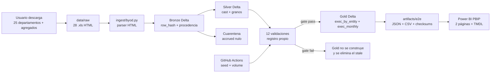

# Arquitectura — PresupuestoAbiertoPE v1.0.0

## Vista general



## Capas y responsabilidades

| Contexto | Responsabilidad | Archivos clave |
|---|---|---|
| `ingest` | Parsear HTML del MEF, generar seed y volumen | `byod.py`, `seed.py`, `bronze.py` |
| `transform` | Tipos, granos, cuarentena | `transforms/silver.py` |
| `quality` | 12 checks, reporte y gate | `quality/registry.py` |
| `analytics` | Agregados, ranking, hallazgos | `analytics/gold.py` |
| `reporting` | CSV, JSON, manifest y checksums | `reporting/artifacts.py`, `reporting/exports.py` |
| `shared` | Spark, config, errores | `shared/spark.py`, `config.py` |
| `dashboard` | PBIR + TMDL + tema | `dashboard/` |

## Decisiones

- **Local-first:** el medallion vive en `data/medallion/`; los datos crudos en `data/raw/` (gitignored).
- **BYOD:** el usuario descarga los exports oficiales; el pipeline no navega ni scrapea. Las 25 exportaciones departamentales son un lote autorizado por el usuario.
- **Un solo Spark:** `shared/spark.py` crea la sesión; ningún otro módulo la instancia.
- **Gate:** cualquier check `fail` bloquea gold y elimina el gold stale.
- **Idempotencia:** bronze/silver se sobrescriben por run; gold también, con `overwriteSchema` para evolución del contrato.
- **Procedencia:** `run_manifest.json` registra SHA-256 de los 28 archivos y 6 payloads.
- **Contrato de datos:** 22 campos canónicos; `department` se aporta por contexto del manifiesto porque el export municipal no repite el departamento.
- **Dashboard:** PBIP/TMDL, 4 tablas desconectadas y 11 medidas; el `.pbix` final se guarda en Desktop.
- **Equivalencia Databricks:** `notebooks/databricks_equivalence.py` es un wrapper de 9 líneas, sin lógica.

## Flujo de un run

```text
python -m presupuesto run --source byod
  → lee data/raw/byod_manifest.json (28 archivos)
  → parsea y escribe bronze
  → tipa y escribe silver + quarantine
  → corre 12 checks y escribe quality_report.json
  → si gate OK: gold + findings + CSV + manifest/checksums
  → si gate fail: elimina gold y termina bloqueado
```

## CI

- `pipeline`: seed clean/dirty y E2E; verifica 12/12 y gate.
- `volume`: 12,800 entidades ≈ 934k filas por el medallion.
- Nunca llama al MEF; el BYOD real solo corre en local.
