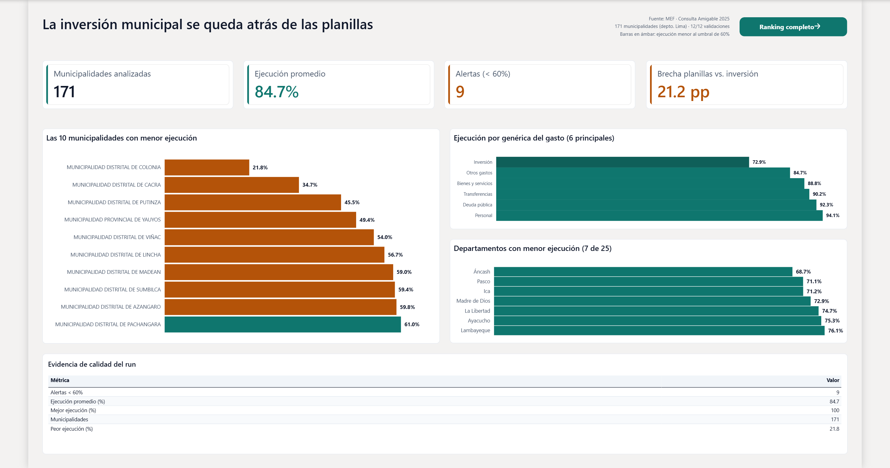
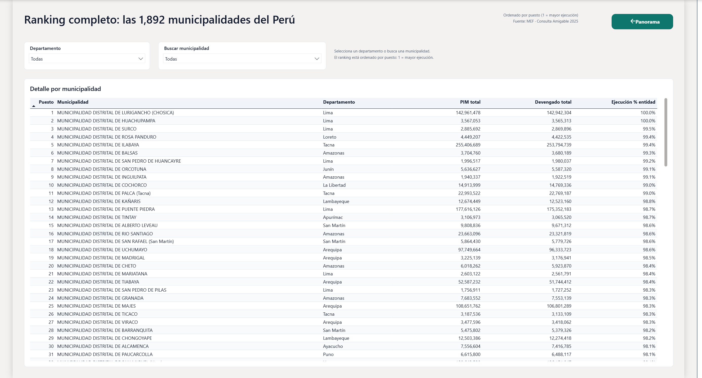

# Dashboard — PresupuestoAbiertoPE 2025 nacional

> **Estado:** PBIP validado y revisado visualmente en Power BI Desktop (19/11/2026).
> **Cobertura:** 1,892 municipalidades de 25 departamentos.
> **Entrega:** el `.pbix` nacional está en `dashboard/PresupuestoAbiertoPE.pbix`; el PBIP es la fuente reproducible.
> **No se publica en Power BI Service en v1.0.**

## Qué contiene

```text
dashboard/
├── PresupuestoAbiertoPE.pbip
├── PresupuestoAbiertoPE.Report/        # PBIR: 2 páginas y 18 visuales
├── PresupuestoAbiertoPE.SemanticModel/ # TMDL: 4 tablas y 11 medidas
└── build_report.mjs                    # regenera las páginas y visuales
```

### Páginas

1. **Panorama — “La inversión municipal se queda atrás de las planillas”**
   - 4 tarjetas: 1,892 municipalidades, 79.5% de ejecución promedio, 196 alertas <60%, brecha de 21.2 pp entre planillas e inversión.
   - Bottom-10 nacional por ejecución (barras ámbar bajo el umbral de 60%; peor: Eleazar Guzmán Barrón, Áncash, 13.2%).
   - Ejecución por 6 genéricas principales (Inversión en teal oscuro; activos financieros omitido por ser un artefacto esperado de 0%).
   - Bottom-7 de 25 departamentos por ejecución.
   - Tabla de evidencia de calidad del run nacional.
2. **Ranking completo — “Las 1,892 municipalidades del Perú”**
   - Selector de **departamento** + selector de búsqueda por municipalidad.
   - Tabla ordenada por puesto (1 = mayor ejecución) con departamento, PIM, devengado y % de ejecución.
   - Botón de regreso al panorama.

La columna `Municipalidad` es única: cuando hay homónimos entre departamentos añade el departamento; si el homónimo persiste dentro del mismo departamento, añade el código de entidad. Así el bottom-10 y la tabla no colapsan municipalidades distintas.

### Modelo semántico

| Tabla | Filas | Origen |
|---|---:|---|
| `ExecutionByEntity` | 1,892 | `artifacts/e2e/execution_by_entity.csv` |
| `CategorySummary` | 10 | `artifacts/e2e/category_summary.csv` |
| `DepartmentSummary` | 25 | `artifacts/e2e/department_summary.csv` |
| `QualitySummary` | 5 | `artifacts/e2e/gold_summary.csv` |

- Las tablas de contexto están **desconectadas** de `ExecutionByEntity` a propósito: son agregados nacionales y filtrarlos por municipalidad sería engañoso.
- El parámetro `DataFolder` apunta a `artifacts/e2e/` en esta máquina. Si mueves el proyecto, actualízalo en `PresupuestoAbiertoPE.SemanticModel/definition/expressions.tmdl`.

## Cómo abrirlo y regenerar el `.pbix`

1. Abre `dashboard/PresupuestoAbiertoPE.pbip` en Power BI Desktop.
2. En la primera apertura, Desktop puede mostrar “una o varias columnas calculadas deben actualizarse manualmente” y tablas vacías: los datos importados aún no se procesaron. Ejecuta **Inicio → Actualizar** (o `RefreshWithXMLA` con `refreshType: Full` desde el MCP de modelado) y espera a que termine.
3. Verifica que el panorama muestre **1,892**, **79.5%**, **196** y **21.2 pp**. Si aparecen `--` o 171, el refresh no terminó o estás sobre el snapshot anterior.
4. El `.pbix` nacional ya está en `dashboard/PresupuestoAbiertoPE.pbix` (240,165 bytes). Si regeneras el modelo/reporte, guarda una copia como `.pbix` con **Archivo → Guardar como**. El PBIP queda como fuente reproducible; el `.pbix` es la entrega.

> La validación visual de este repositorio se hizo con el modelo refrescado y el panel de filtros colapsado. Las capturas están en `docs/screenshots/`.

## Evidencia visual





## Validación

- `powerbi-report-author validate dashboard/PresupuestoAbiertoPE.Report` → **0 errores, 0 warnings**.
- `powerbi-report-author preview ... --host desktop --all-pages --scale 2` → 2 páginas capturadas, sin fallos.
- Modelo recargado desde TMDL y refrescado: 4 tablas, 11 medidas, 1,892 municipalidades, 25 departamentos.
- La tabla de calidad no tiene fila Total; el ranking tampoco. Los encabezados numéricos están alineados a la derecha.

## Limitaciones

- Un solo año (2025) y solo gastos.
- 1,892 municipalidades del universo municipal de ~1,900; la fuente puede variar en el cierre anual.
- El año 2025 se consultó el 18–19/11/2026; el SIAF puede registrar ajustes posteriores.
- Los nombres con ruido de codificación de la fuente se preservan.
- El dashboard describe ejecución presupuestal, no intenciones ni causas.
